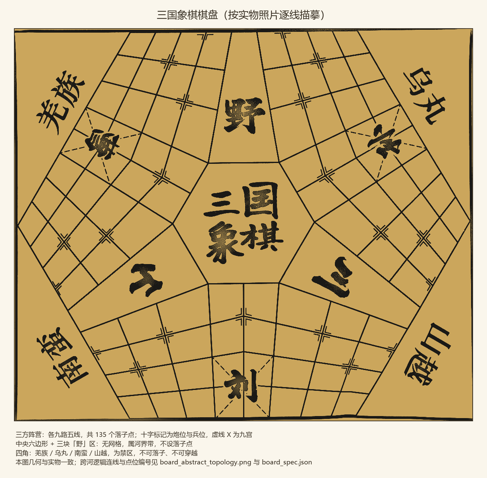
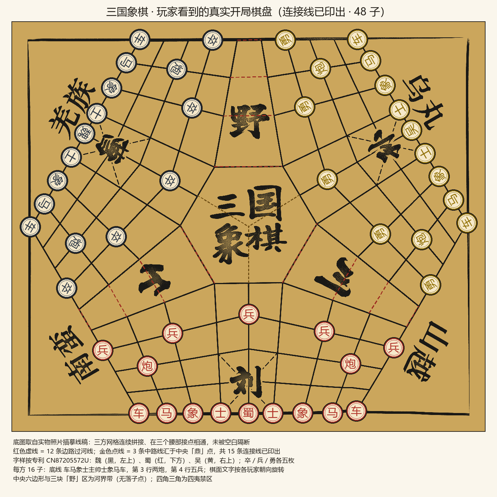
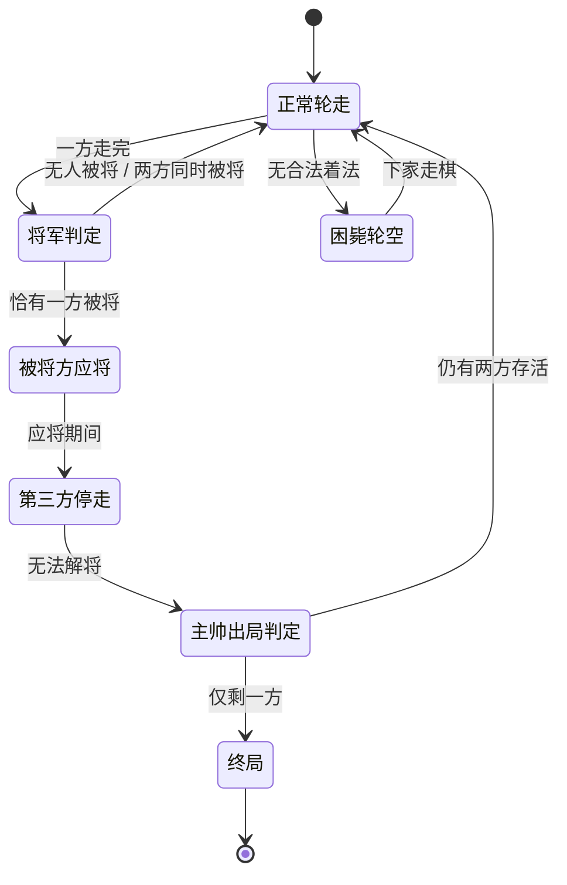

# 三国象棋（三方鼎立棋盘版）规则与 AI 开发规格

文档版本 2.4 | 2026-11-14 | 依据：用户提供的棋盘照片 + 专利 CN87205572U 说明书全文

> 1.1 修订：主图改为按实物照片逐线描摹的棋盘图；旧「逻辑拓扑抽象示意」降级为附录对照图。
> 1.2 修订：新增玩家看到的开局棋盘（48 子）、三方各自视角、点位编号图与渲染坐标。
> 1.3 修订：修正核心几何误解——三方网格连续拼接、彼此相通，不是被野区隔开的三块孤岛。
> **2.0 修订（规则定稿 + 可玩实现，重要）**：查到 1987 年专利 CN87205572U 说明书全文，确认本棋盘就是该专利的「三国象棋」，**不是三国演弈棋**（无汉帝、无结盟、无弑君）。棋子字样、48 子构成、12 根虚线用途、河界算一格、兵升变、败方余子冻结、走棋顺序与计分全部有权威依据，第 11 章待确认项以第 12 章定稿为准。同时按用户要求**把 12 条边路虚线与 3 条中路线印在棋盘上**，并交付可玩的微信小程序与网页试玩版（玩家执一方，另两方由端上 AI 执棋）。详见第 12 章。
> 2.1 修订：按用户反馈放大棋子与全部文字，渲染尺寸参数收敛为可配置项，见 12.7。
> **2.2 修订（规则缺陷）**：修复炮的走法——旧实现让炮完全不能走到空格、只能隔河吃子，且中路跨河分叉时两条射线共用一个炮架状态。同时让 `dashed_for_pawns_only` 开关真正接入引擎。详见 12.9。
> **2.3 修订（人数可配置）**：新增 1～3 人同屏对局，玩家席位可选，空缺席位由端上 AI 自动补齐；多人局有换人交接遮挡、席位文案与悔棋回合回退。网页版与小程序同步，详见 12.10。
> **2.4 修订（提示标记加醒目）**：重做选中环与落子提示的视觉层次——修复可吃子红圈被棋子完全遮挡的缺陷，标记改为画在棋子之上；选中环加粗加亮并给棋子本体加金色发光。详见 12.11。

配套文件（同目录）：

| 文件 | 用途 |
| --- | --- |
| `board_spec.json` | 机器可读规格：135 个点、边表、分区、开局摆法、规则开关、待确认项 |
| `board_topology.svg` / `board_topology.png` | **文档主图**：从照片逐线描摹的棋盘，几何与实物一致 |
| `board_reference_traced.png` | 纯线稿，无标注无边距，供程序 / 渲染对齐直接使用 |
| `board_abstract_topology.svg` / `.png` | 逻辑拓扑抽象示意（非实物比例），仅用于说明跨河连线与分区，不用于渲染 |
| `board_player_view.png` | **玩家看到的开局棋盘**：照片线稿为底 + 48 枚棋子，几何与实物一致 |
| `board_player_views.png` | 三方各自坐下时的视角对照 |
| `board_connectivity.png` | 连通关系标注：三方国境线相接、三个腰部接点、15 条连接线 |
| `board_point_ids.png` | 照片线稿 + 135 个点的 `f/r` 编号 |
| `board_real_coords.json` | **135 个点的真实照片像素坐标**、渲染偏移、48 枚初始摆子、12 条对接线 + 3 条中路线 |
| `play/三国象棋_试玩版.html` | **单文件网页试玩版**，双击即可玩（1～3 人，空位由 AI 补齐） |
| `play/index.html` + 三个 `.js` | 网页版源码（数据 / 规则引擎 / 绘制层分离，便于调试；含 `SanguoDebug` 回归钩子） |
| `../sanguo-mini/` | **微信小程序工程**：原生 WXML/WXSS + canvas 2d，规则与网页版共用 |
| `build_game_assets.py` | 把实测坐标与专利字样编译为两端共用的 `board-data.js` |
| `trace_reference.py` | 从照片生成主图与纯线稿的脚本 |
| `render_real_board.py` | 生成开局棋盘 / 三视角 / 连通图 / 编号图 / 真实坐标的脚本 |
| `archived_parametric_board.py` | 已废弃的参数化扇形重绘脚本（错误几何，仅留档，输出加 `parametric_` 前缀） |
| `build_board_spec.py` | 生成规格 JSON 与抽象示意图，并自检的脚本（可直接改参数重跑） |

---

## 0. 关键结论

1. **这是「三方鼎立」版三国象棋**（网格部分 120° 旋转对称），不是市面上常见的「三国演弈棋」正方形四方布局。两者四角都标了羌族、乌丸、南蛮、山越，极易混淆，但棋盘结构不同。
2. **三方各占一个「九路五线」的变形中国象棋半盘**：9 条纵线 × 5 条横线 = 45 个落子点/方，共 **135 个落子点**。该数字与 1987 年《三国象棋》专利 CN87205572U 完全一致。
3. **中央六边形 + 3 块无网格「野」梯形构成河界带（中原）**，默认不设落子点，只作为「河界算一格」的跨越带；**四角无网格的小三角区是四夷禁区**，不可落子、不可穿越。
4. **三方纵线在河湾两两对接**：每对相邻国家 4 条、共 12 条跨河连线；三条中路汇于中央「鼎」点。这 12 条与专利所述「12 根虚线」数量吻合。
5. **棋子与开局摆法与中国象棋完全相同**：每方 16 枚（帅 1、士 2、相 2、马 2、车 2、炮 2、兵 5），共 48 枚；照片上的「十」字标记即炮位与兵位。
6. 照片只有棋盘、没有规则书，而三方象棋存在多个规则流派。本规格把内容分成 **照片可确认项 / 公开通行规则 / 实现建议 / 待确认项** 四类，并把所有分歧做成开关，便于先落地一版可运行的 AI，再逐项校准。

---

## 1. 证据分级与适用范围

| 级别 | 含义 | 处理方式 |
| --- | --- | --- |
| L1 | 照片可直接确认 | 作为硬约束，不改 |
| L2 | 公开资料中的通行规则 | 作为默认规则，注明出处 |
| L3 | 本规格给出的实现建议 | 可配置，便于替换 |
| L4 | 照片与资料均未明确 | 列入第 11 章待确认清单，做成开关 |

适用范围：三人（或一人执三方 / 人机）对弈的棋类引擎、棋谱回放、AI 搜索与评估、棋盘渲染。不覆盖古版「三友棋 / 三国图格」18 子带旗、火的玩法，也不默认启用「三国演弈棋」的汉方结盟玩法。

---

## 2. 棋盘布局规格（核心）

### 2.1 整体几何 [L1]

- 外框为**横向矩形**（照片内框约 1116×953 px，宽高比约 1.17；可能源于印刷比例或拍摄透视）；几何中心记为 `O`。
- **网格部分**呈 120° 旋转对称：三个阵营分别位于**下方（A）**、**左上（B）**、**右上（C）**。矩形外框与四角留白不参与该对称，因此整体并非严格几何对称。
- 三个九宫的虚线 X 分别位于三方的底线中央，旋转 120° 后互相重合，是判定对称性的最可靠依据。
- 每个阵营是**梯形 / 扇形网格**：纵线呈放射状指向 `O`，横线是**逐点相连的折线**（不是一条直线），中段与两侧段方向不同。这是把中国象棋半盘「从河界拆开、把 180° 掰成 120°」后的结果。
- **三方网格是连续拼接、彼此相通的一整片**：从外框到三方国境线（`r=4`）之间几乎铺满网格，相邻两方在三个「腰部」紧贴相接、线条贯通。三块「野」区只是从腰部向内延伸到中央六边形的窄缝隙，**不是把棋盘切成三块孤岛**；四角仅留 4 块小三角空白区。
- 三方的 `r=4` 国境线首尾相连，围成一个闭合的大六边形轮廓；中央小六边形的三条交替边就是这三段国境线的中段。大、小六边形之间即三块「野」区。



> 渲染请以本图为准。`board_abstract_topology.png` 只是点位拓扑的抽象画法，形状与实物差异较大，原因见 2.1.1。

#### 2.1.1 为什么抽象示意图与照片相差很远 [L3]

旧版抽象图（现已归档为 `board_abstract_topology.*`）当初是为讲清「135 点 / 跨河边 / 禁区」而画的**逻辑拓扑图**，不是实物复刻，而且几何参数本身也有偏差：

| 项 | 照片实物 | 旧抽象图 | 造成的观感差异 |
| --- | --- | --- | --- |
| 阵营覆盖范围 | 三方网格连成一片、三个腰部相接、彼此相通 | 三个窄扇形，彼此之间大片空白 | 像三座互不相连的孤岛 |
| 横线 | 9 个点逐段相连形成的折线 | `f=0` 直连 `f=8` 的一条直线 | 丢失六边形环的折线结构 |
| 中央 | 单个六边形 | 大、小两个六边形组成的环带 | 多出一圈实物没有的区域 |
| 野区 | 3 块从腰部向内延伸到中央六边形的窄梯形缝隙 | 六边形环带 / 从外框一路铺到中央的宽梯形 | 分区形状完全走样 |
| 四角 | 4 块小三角留白 | 200×200 的大三角 | 网格被压缩到棋盘中部 |
| 表现层 | 黄底单色黑线，只有炮位/兵位十字与九宫虚线 | 红/绿/黑三色、135 个圆点、A/B/C 标签、跨河虚线、图例 | 便于讲规则，但完全不像棋盘 |

修正方式：主图 `board_topology.*` 改为直接从照片提取线条描摹，几何逐线一致；抽象图保留用于说明跨河逻辑边。两者用途分离，不再混用。生成器分别是 `trace_reference.py` 与 `build_board_spec.py`。

#### 2.1.2 三方是连在一起、相通的（v1.2 的错误与修正）[L1，关键]

v1.2 的 `board_player_view.png` 用参数化扇形重绘，把三方画成**被大片浅色野区和巨大四角三角彻底隔开的三块孤岛**。用户指出这不对：照片上三个地方是连在一起、相通的。复核后确认用户正确：

| 项 | 照片实物 | v1.2 参数化图（已废弃） |
| --- | --- | --- |
| 三方网格 | 从外框一直铺到国境线，相邻两方在左、右、上三个腰部**直接相接**，线条贯通 | 三块扇形各自独立，中间夹着 200–300 px 的空白 |
| 国境线 | 三方 `r=4` 折线**首尾相连**，围成闭合大六边形轮廓 | 三条互不接触的独立折线 |
| 野区 | 只存在于大六边形轮廓与中央小六边形之间的窄缝隙 | 从中央一路延伸到外框的宽梯形，把网格切断 |
| 四角 | 4 块小三角留白 | 245 px 大三角，把网格挤到棋盘中部 |
| 连通 | 相邻两方边路纵线端点两两对接，12 条对接线可跨区行棋 | 视觉上完全无法通行 |

**修正做法**：不再参数化重绘。 `render_real_board.py` 直接以 `board_reference_traced.png`（照片逐线描摹）为底图，用长直线求交标出 135 个真实交点，按每方 9 路 × 5 线编号后把 48 枚棋子摆上去。因此棋盘几何与参考照片逐像素一致，连通性天然正确。

实测验证（`board_real_coords.json`，照片像素坐标）：

| 相邻对 | 最近的一对国境线端点 | 距离 |
| --- | --- | --- |
| A / B | `A(0,4)` (194, 894) ↔ `B(8,4)` (156, 828) | 75 px |
| A / C | `A(8,4)` (1156, 883) ↔ `C(0,4)` (1192, 820) | 72 px |
| B / C | `B(0,4)` (640, 8) ↔ `C(8,4)` (712, 8) | 72 px |

三处即「腰部」，缝隙只有 70–75 px（棋盘宽 1348 px 的约 5%），远不是把三方切成孤岛。每对相邻国各有 4 条边路纵线端点两两对接，共 12 条，标注见 `board_connectivity.png`。

### 2.2 分区清单 [L1]

| 分区 | 数量 | 有网格 | 可落子 | 作用 |
| --- | ---: | --- | --- | --- |
| 阵营区 `camp_A/B/C` | 3 | 是，9×5 | 是，各 45 点 | 本方阵地，含九宫、炮位、兵位、防线、国境线 |
| 河界野区 `wild_1/2/3` | 3 | 否 | 否 | 上方、左下、右下三块**窄梯形**「野」区，各自从相邻两方国境线相接的腰部向内延伸到中央六边形；是窄缝隙，不是隔断 |
| 中心区 `center_ding` | 1 | 否 | 默认否 | 中央六边形，三条中路汇合处（鼎点） |
| 四夷禁区 `barbarian_1..4` | 4 | 否 | 否 | 矩形外框四角的空白小三角，标注羌族、乌丸、南蛮、山越 |

要点：**能落子的只有三方阵营网格的 135 个交叉点**。中央区与四角区只是空白区域，不提供落子点。三方网格在外框与国境线之间连成一片、相接相通；野区只占国境线以内的中央部分，不可理解为把棋盘切成三块。

### 2.3 阵营网格 [L1]

对每一方建立本地坐标 `(f, r)`：

| 项 | 定义 |
| --- | --- |
| `f`（路） | 0..8，本方视角从左到右；`f=4` 为中路 |
| `r`（线） | 0..4，`r=0` 为底线（帅所在），`r=4` 为国境线/前线 |
| 本方前进方向 | `r` 增大，即指向棋盘中心 |
| 落子点数 | 9 × 5 = 45 |

特殊线位点：

| 名称 | 坐标 | 说明 |
| --- | --- | --- |
| 九宫 | `f∈{3,4,5}`, `r∈{0,1,2}` | 3×3，带虚线对角线（照片可见） |
| 炮位 | `(1,2)`, `(7,2)` | 照片「十」字标记 |
| 兵位 / 防线 | `(0,3),(2,3),(4,3),(6,3),(8,3)` | 照片「十」字标记；`r=3` 为防线 |
| 国境线 | `r=4` 的 9 个点 | 跨越后即进入河界/他国 |

### 2.4 中央野区与跨河连接 [L1 + L2 + L3]

照片中央区没有画出任何连线，但三方必须能交战。通行做法是把河界当作**一格宽的空白带**（与中国象棋河界相同）：

> 「三角形的河界与中国象棋中的长形河界相同，在棋盘上算作一格」——CN87205572U

因此规格定义：

1. **跨河纵线（12 条）**：从本方 `r=4` 的某个点，沿纵线「前进」1 步，直接落到相邻国家的 `r=4` 点，中间不设落子点。
2. **相邻国家对**：逆时针顺序为 `A → C → B → A`（见 3.1），共 3 对：`(A,C)`、`(C,B)`、`(B,A)`。
3. **配对公式**：对相邻对 `(s, t)`，`s` 的 `f=5,6,7,8` 分别接 `t` 的 `f=3,2,1,0`（即 `f_t = 8 - f_s`）。每对 4 条，3 对共 12 条。
4. **中线左右约束** [L2]：`f<4` 的边路只能进入左邻国，`f>4` 的边路只能进入右邻国，`f=4` 中路可经中央鼎点进入任意一国。对应「中线左边的只能过左边的河，中线右边的只能过右边的河，中线上的可随便进入任何一国」。
5. **三条中路** [L3]：
   - 默认 **135 点模型**：三方的 `(4,4)` 两两互联（3 条边），中央「鼎」点只是视觉汇合处，不是落子点。
   - 可选 **136 点模型**：新增中心点 `X00`，三方的 `(4,4)` 各与 `X00` 相邻（1 步）。开关见 `board_spec.json → board.optional_edge_groups.center_ding_point`。

`board_spec.json` 中边表分三类：`intra_edges`（228 条阵内边）、`river_edges`（12 条）、`center_edges`（3 条）。每条跨河边带 `allowed` 字段，默认允许车、马、炮、兵使用。

### 2.5 四角禁区 [L1 + L2]

- 四角三角区内无任何交叉点，因此**不存在合法的落子目标**；车、炮、兵不能进入。
- 该区域还会切断棋路：车/炮的直线扫描不得穿过禁区，马若在边角处无法构成完整的「日」字（即日字路径要借道禁区），该跳法无效。
- 四角可作为「俘虏区」放置被吃掉的子或被收编的主帅（三国演弈棋玩家习惯用法），属可选美化，不影响规则。

### 2.5.1 玩家看到的开局棋盘（用于核对理解）[L1 + L2 + L3]

`board_player_view.png` **直接以 `board_reference_traced.png`（照片逐线描摹线稿）为底图**，48 枚棋子摆在从线稿实测出的交点上；`board_player_views.png` 给出三方各自坐下时的视角；`board_connectivity.png` 标注连通关系；`board_point_ids.png` 标出 135 个点的 `f/r` 编号；`board_real_coords.json` 给出**照片像素坐标**（画布 1348×1155，渲染时加 48 px 纸边）。



> 棋盘几何与参考照片逐线一致，**三方网格连成一片、在三个腰部相接、彼此相通**。v1.2 那张参数化扇形重绘把三方画成孤岛，已废弃，原因见 2.1.2。主图上**没有画 12 条跨区对接线**——照片本来就没印，它们只是 `board_spec.json` 里的逻辑边；单独的可视化见 `board_connectivity.png`。

**摆子行号校验**：对照片上炮位/兵位的十字标记做局部响应检测，A 方 `r=2` 的 `f=1,7` 与 `r=3` 的 `f=0,2,4,6,8` 得分最高，与摆子行完全一致，说明 `r=0` 在外、`r=4` 在内、以及两炮五兵的行号方向正确。

请重点核对以下 8 项；若与实物规则卡不符，只需改配置或摆子表，不必改架构：

| # | 我的理解 | 依据 | 若不对会影响 |
| --- | --- | --- | --- |
| 1 | 三方位置：A 下、B 左上、C 右上，逆时针轮换 `A → C → B` | L1 照片 | 坐标系统、行棋顺序 |
| 2 | 每方 9 路 5 线，`r=0` 底线、`r=4` 国境线，横线是折线 | L1 照片 | `DIR_TABLE`、着法生成 |
| 3 | 每方 16 子，摆法同中国象棋（车马相仕帅仕相马车 / 两炮 / 五兵） | L2 推断 | 开局状态、AI 评估 |
| 4 | 棋面文字按玩家朝向旋转：A 正、B -120°、C +120° | L3 实现建议 | 纯 UI |
| 5 | 中央六边形 + 3 块「野」梯形为河界带，无落子点 | L1 + L2 | 跨河边、河界算一格 |
| 6 | 四角三角为禁区，不可落子、不可穿越 | L1 + L2 | 车炮射线、马腿判定 |
| 7 | 棋盘上不印跨区对接线，12 条是逻辑边；三方靠腰部接点与对接线相通 | L1 + L3 | 渲染与规则分离 |
| 8 | 三方国名与棋面字样：本图统一用 A/B/C + 中国象棋字，未推断魏蜀吴字样 | L4 待确认 | 纯命名 / UI |

底图与坐标来自照片，不再有「观感差异」。摆子表在 `render_real_board.py` 的 `BACK` / `PIECES`，点位编号来自 `board_real_coords.json`；改摆法只改这两处。

### 2.6 与「三国演弈棋」的区别 [L2，重要]

| 维度 | 本棋盘（照片版） | 三国演弈棋（2005，CN2870925） |
| --- | --- | --- |
| 棋盘形状 | 横向矩形外框内，网格 120° 三方鼎立 | 正方形，三方在上、下、右 |
| 中央区 | 「野」区，无落子点，作河界 | 中原有落子点，设汉帝与三车一炮 |
| 落子点 | 135（3×45） | 未采用 135 点模型 |
| 棋子 | 48（每方 16） | 53（三方 48 + 汉方 5） |
| 四角 | 羌族、乌丸、南蛮、山越（禁区） | 同名四角（禁区） |
| 特色机制 | 跨河作战、中路鼎点 | 结盟点、弑君、黄棋激活、兵力收编 |

结论：**四角标注相同不代表规则相同**。照片上未见汉帝位、结盟点、黄棋点位，因此本规格默认关闭结盟/弑君/汉方，只作为可选模块（第 7 章）。

---

## 3. 坐标系统与数据模型（AI 实现）

### 3.1 命名与方位 [L3]

| 常量 | 值 |
| --- | --- |
| `SIDES` | `A`（下/南，红）、`C`（右上/东北，绿）、`B`（左上/西北，黑） |
| 逆时针顺序 | `A → C → B → A` |
| 点 ID | `{side}{file}{rank}`，如 `A40` = A 方中路底线（帅初始位） |
| 方向角（用于渲染） | A=270°，C=30°，B=150°（数学角，屏幕 y 轴向下需取负） |

### 3.2 不要用二维矩阵，要用图 [L3]

棋盘是三向拼接、跨河后坐标会「换国家」，二维 `9×5×3` 数组无法直接表达邻接关系。推荐模型：

```
Board = {
  points:  Point[135],                 # 点 ID
  edges:   Edge[],                     # 无向边，含类型与可用棋子
  zones:   Zone[],                     # 分区属性
  dirTable: DIR_TABLE[owner][point][8方向]   # 静态预计算，见下
}
Edge = { a, b, kind: intra_h | intra_v | river | center | dashed, allowed: pieceType[] }
```

**关键实现建议（最易出错处）**：棋子的「前 / 后 / 左 / 右」是**棋子所属方**的属性，不是它当前所在阵营的属性。A 方兵在本国前进是 `r+1`（朝中心），跨河进入 C 国后继续前进则是 C 的 `r-1`（朝 C 底线），方向在本地坐标上发生了翻转，但在全局几何上仍是同一条直线。

因此不要在运行期用 `f/r` 推断方向，而是**预计算静态方向表**：

```
DIR_TABLE[owner_side][point_id][direction] -> target_point_id | null
direction ∈ {front, back, left, right, front_left, front_right, back_left, back_right}
```

- 阵内方向按本方 `f/r` 直接生成。
- 跨河方向按 2.4 的配对公式生成，并保证「从 s 的 (f,4) 前进一步 = t 的 (8-f,4)」，之后从该点继续前进 = t 的 `r-1`。
- 这样车/炮的直线扫描、马的「日」字、相的「田」字都只需反复查表，天然跨区连续。

### 3.3 渲染坐标 [L3]

如需把点 ID 映射到屏幕坐标，使用每方朝向向量做线性插值（脚本 `build_board_spec.py` 中 `pos()` 即此实现）：

```
u(s) = (cos θs, -sin θs)              # 中心指向该方
v(s) = (u.y, -u.x)                    # 该方视角的「右」
d(r) = lerp(D0, D4, r/4)             # 底线到前线的距离
l(r) = lerp(L0, L4, r/4)             # 半宽，纵线放射状收敛
P(s,f,r) = O + d(r)·u(s) + ((f-4)/4)·l(r)·v(s)
```

B、C 两方即对 A 绕 `O` 旋转 ±120°。`build_board_spec.py` 中的 `pos()` 采用 `D0=300, D4=140, L0=250, L4=82`，**这只用于生成逻辑抽象示意图，不是实物比例**：抽象图的扇形偏窄、横线画成直线，与照片不吻合。渲染真实棋盘时请以 `board_topology.png`（照片描摹）为几何基准，或按该线稿标定 135 个交点的屏幕坐标，不要直接套用 `D0/D4/L0/L4`。

### 3.4 `board_spec.json` 字段速查

| 路径 | 内容 |
| --- | --- |
| `board.points` | 135 个点 ID |
| `board.intra_edges` | 228 条阵内边（横向 + 纵向） |
| `board.river_edges` | 12 条跨河纵线，含 `allowed` |
| `board.center_edges` | 3 条中路互联边 |
| `board.optional_edge_groups` | 专利 12 根兵卒虚线、中央鼎点（均默认关闭） |
| `board.frame_note` / `board.symmetry_note` | 外框实测比例、120° 对称仅适用于网格的说明 |
| `board.shape_note` / `board.geometry_source` | 实物几何要点、几何基准来源 |
| `board.diagram_files` | 主图 / 纯线稿 / 抽象图各自用途 |
| `board.zones` | 3 阵营 + 3 野区 + 1 中心 + 4 禁区 |
| `board.special_points` | 每方九宫、炮位、兵位、防线、国境线 |
| `pieces.initial_placement` | 48 条 `{side, type, at}` |
| `rules.flags` | 全部规则开关 |
| `open_questions` | 10 条待确认项 |

### 3.5 对局状态对象示例 [L3]

```json
{
  "ply": 0,
  "side_to_move": "A",
  "turn_order": ["A", "C", "B"],
  "pieces": [
    {"id": "A_R_1", "owner": "A", "type": "R", "at": "A00", "frozen": false}
  ],
  "alive": {"A": true, "B": true, "C": true},
  "check": {"A": false, "B": false, "C": false},
  "frozen_side": null,
  "alliance": null,
  "han_activated": false,
  "halfmove_since_capture": 0,
  "rule_flags": "见 board_spec.json → rules.flags"
}
```

---

## 4. 棋子与开局摆法 [L1 + L2]

三方各 16 枚，共 48 枚；摆法与中国象棋完全一致。

| 类型 | 代号 | 每方数量 | 初始 `(f,r)` | 点 ID 示例（A 方） |
| --- | --- | ---: | --- | --- |
| 帅 / 将（魏、蜀、吴） | `K` | 1 | `(4,0)` | `A40` |
| 士 / 仕 | `A` | 2 | `(3,0),(5,0)` | `A30,A50` |
| 相 / 象 | `E` | 2 | `(2,0),(6,0)` | `A20,A60` |
| 马 | `N` | 2 | `(1,0),(7,0)` | `A10,A70` |
| 车 | `R` | 2 | `(0,0),(8,0)` | `A00,A80` |
| 炮 | `C` | 2 | `(1,2),(7,2)` | `A12,A72` |
| 兵 / 卒 / 勇 | `P` | 5 | `(0,3),(2,3),(4,3),(6,3),(8,3)` | `A03,A23,A43,A63,A83` |

说明：

- 三方主帅可分别写作「魏、蜀、吴」或「将、帅、王」；兵类在三方可分别称「卒、兵、勇」，仅命名差异。
- 照片上的「十」字标记正好对应炮位（2 个）与兵位（5 个），是「摆法同中国象棋」的直接证据。
- 古版「三友棋 / 三国图格」为每方 18 子（增旗、火，减卒），照片未体现，故不采用；如需支持，见 `open_questions`。

---

## 5. 走法规则

### 5.1 基线 [L2]

以中国象棋为基线：车走直线、炮隔子打、马走日、相走田、士斜走一格且不出九宫、帅直走一格且不出九宫、兵一步一格。所有走法在 3.2 的 `DIR_TABLE` 上实现。

### 5.2 差异项与规则开关 [L2 + L3]

下表默认值已写入 `board_spec.json → rules.flags`，可直接切换。

| 开关 | 默认值 | 含义 | 依据/说明 |
| --- | --- | --- | --- |
| `horse_leg_block` | `false` | 马不蹩马腿 | 三方版通行做法，强化骑兵 |
| `elephant_eye_block` | `false` | 相不塞象眼 | 三方版通行做法 |
| `elephant_cross_river` | `false` | 相不过河 | 专利与鼎弈均如此 |
| `advisor_cross_river` | `false` | 士不过河 | 守九宫 |
| `general_diagonal` | `false` | 帅不斜走 | 部分民间玩法允许斜走一格，可开 |
| `soldier_sideways_in_own_camp` | `true` | 兵在本国境内可横走（不可后退） | 强化防线，三方版常见 |
| `soldier_backward_after_river` | `true` | 兵过河后可前后左右走，后退最多退回本国国境线 | 三方版常见 |
| `soldier_promote_at_enemy_base` | `false` | 兵到对方底线升为车的走法 | 专利 1987 版特有，默认关 |
| `cannon_first_turn_no_cross_border` | `false` | 炮首回合不得走出国境线 | 三国演弈棋规则，默认关 |
| `cross_river_pieces` | `["R","N","C","P"]` | 可跨河兵种 | 默认车马炮兵；相士将禁 |
| `check_side_moves_first` | `true` | 被将方立即应将 | 三方版通行 |
| `third_party_frozen_during_check` | `true` | 应将期间第三方停走，其棋子不可被吃、不可被穿越 | 三人象棋玩法一 |
| `stalemate_passes_turn` | `true` | 困毙轮空，由下家走 | 三国演弈棋 |
| `defeated_pieces` | `frozen_obstacle` | 败方余子原地冻结为障碍 | 可选 `annexed`（收编）/ `removed` |
| `alliance_enabled` / `han_faction_enabled` | `false` | 结盟、汉方 | 照片未见点位，默认关 |

### 5.3 三方特有判定 [L2 + L3]

1. **过河判定**：棋子所在点不属于其所属方阵营（即点 ID 首字母 ≠ `owner`），或曾经过 `river/center` 边，即视为「已过河」。此后获得横走/后退能力。
2. **目标国选择**：`f<4` 只能进左邻国，`f>4` 只能进右邻国，`f=4` 可经中央鼎点进入任意一国。
3. **相 / 士 / 将**：合法点集合恒为本方 45 点内的子集，不得使用 `river/center/dashed` 边。
4. **车 / 炮射线**：沿 `DIR_TABLE` 逐点推进；遇到禁区边界即终止；炮翻越的「炮架」可以是任意一方的棋子，但停走方的棋子只能阻挡、不能被吃。
5. **马**：按「日」字查表；若 `horse_leg_block=true`，马腿点同样用 `DIR_TABLE` 定位。马的目标点、途经点均不得落在四角禁区（禁区无点，主要通过「路径是否跨越禁区边界」判定）。

### 5.4 着法生成伪代码 [L3]

```python
def generate_moves(state, piece):
    owner = piece.owner
    tab = DIR_TABLE[owner]                     # 静态方向表
    out = []

    if piece.type == 'R':                      # 车：沿四个正方向扫描
        for d in ('front', 'back', 'left', 'right'):
            p = tab[piece.at][d]
            while p is not None:
                target = state.at(p)
                if target is None:
                    out.append(Move(piece.at, p))
                elif target.owner != owner and not target.frozen:
                    out.append(Move(piece.at, p, capture=target.id))
                    break
                else:
                    break                      # 己方或停走方棋子阻挡
                p = tab[p][d]

    elif piece.type == 'C':                    # 炮：隔一个炮架吃子
        for d in ('front', 'back', 'left', 'right'):
            p, screen = tab[piece.at][d], False
            while p is not None:
                target = state.at(p)
                if not screen:
                    if target is None:
                        out.append(Move(piece.at, p))
                    else:
                        screen = True
                else:
                    if target is not None:
                        if target.owner != owner and not target.frozen:
                            out.append(Move(piece.at, p, capture=target.id))
                        break
                p = tab[p][d]

    elif piece.type == 'N':                    # 马：日字，可选蹩腿
        for d, leg in HORSE_OFFSETS:
            if RULE.horse_leg_block and state.at(tab[piece.at][leg]) is not None:
                continue
            p = two_steps(tab, piece.at, d)
            if p and can_land(state, owner, p):
                out.append(Move(piece.at, p))

    # 相、士、帅、兵同理：先由 DIR_TABLE 找候选点，再用区域约束过滤
    return [m for m in out if legal_after_move(state, m)]   # 不能自将
```

`legal_after_move` 必须做三方将军检测：走完后若己方主帅被任一方攻击，该着法非法。

---

## 6. 回合流程与状态机 [L2 + L3]

### 6.1 基本流程

1. 默认 `A → C → B → A` 逆时针轮流，每方每回合走一步（可配置 `turn_order` 与 `first_side`）。
2. **被将先走**：若某方被将，下一步由被将方立即应将，跳过正常顺序；应将解将后，回到正常顺序。
3. **第三方停走**：应将期间，既非将军方也非被将方的第三方停走，其棋子不可被吃、不可被穿越，但仍作为障碍存在。
4. **两方同时被将**：不触发优先权，按正常顺序走棋。
5. **困毙**：轮到某方却无合法着法且未被将，该方轮空，由下家走棋。
6. **主帅被将死 / 被吃**：该方立即出局，触发第 7、8 章处理。

### 6.2 状态机



### 6.3 需要写入状态的字段

`side_to_move`、`alive[3]`、`check[3]`、`frozen_side`（停走方）、`alliance`、`han_activated`、`halfmove_since_capture`、`defeated_pieces_mode`。Zobrist 哈希必须包含 `side_to_move`、`alive`、`check`、`frozen_side`、`alliance`，否则置换表会串局。

---

## 7. 可选机制模块（默认关闭）

这些机制来自其他版本，**照片未提供对应点位**，实现时请保持开关化。

| 模块 | 来源 | 规则摘要 | 开关 |
| --- | --- | --- | --- |
| 汉方 + 结盟 + 弑君 | 三国演弈棋 | 中央设汉帝与三车一炮，静止且不可被吃；任一方用马跳到「魏/蜀/吴」结盟点即结盟，盟友间不可互吃，黄棋归未结盟方；用马杀汉帝后另两方自动结盟，弑君方收编三车一炮；结盟/弑君全局仅一次；联盟在第三方被灭后解体 | `alliance_enabled`, `han_faction_enabled` |
| 兵力收编 | 三国演弈棋 | 将死一方后，胜者指挥败者残兵；若两方同时将死，以最后造成将军者为收编者 | `defeated_pieces = annexed` |
| 余子冻结 | 专利 1987 / 鼎弈 | 主帅被将死后提走，在原位放入「吃将」棋子，败方其余棋子原地不动，任另外两方吃掉；鼎弈版称为「冻结为障碍」 | `defeated_pieces = frozen_obstacle`（默认） |
| 12 根兵卒虚线 | 专利 1987 | 12 根虚线连接相邻边路交点，仅供兵卒勇过河后往返另外两方阵地，不得经虚线退回本方，其它棋子禁用 | `board.optional_edge_groups.patent_1987_soldier_dashed` |
| 兵升变 | 专利 1987 | 兵到达对方底线后按车的走法行动 | `soldier_promote_at_enemy_base` |
| 三座山地形 | 三人象棋玩法一 | 棋子不可翻越三座山；中线左侧只过左河、右侧只过右河；被将时第三方停走 | 与 2.4 中线约束、6.1 停走规则重合，可视为默认已覆盖 |
| 俘虏区 | 玩家习惯 | 四角禁区用于放置被吃的子与被收编的主帅 | 纯 UI，规则无影响 |

---

## 8. 胜负与计分 [L2]

| 情形 | 判定 |
| --- | --- |
| 一方主帅被将死 / 被吃 | 该方出局，`alive[side]=false` |
| 仅剩一方存活 | 该方胜，「一统天下」 |
| 最后两方和棋 | 可采纳「先胜第一方者为最终胜者」或按积分裁定 |
| 积分制（可选） | 一统天下 3 分，和棋各 1 分；鼎弈版为 60 回合无吃子按吃子积分裁定名次 |
| 困毙 | 不判负，轮空由下家走 |

如启用「收编」模式，出局判定后不清除败方棋子，而是把 `owner` 改为胜者（或标记为受控），并继续对局。

---

## 9. AI 实现要点

| 主题 | 建议 |
| --- | --- |
| 状态编码 | `int8[135]` 存「兵种 + 归属」，另设 `alive[3]`、`frozen[3]`、`alliance`、`check[3]`；冻结子仍占点、可作炮架与障碍，但不可移动、不可被吃 |
| 着法生成 | 全部基于 `DIR_TABLE[owner][point][dir]`，不要运行期做几何运算；跨河边带 `allowed` 过滤 |
| 将军检测 | 三方互检：对每位存活主帅，检查另外两方（含结盟关系）是否存在攻击着法；停走方棋子只阻挡不参与攻击 |
| 搜索 | 三方用 MaxN / Paranoid 搜索；启用结盟后需按联盟分组做 coalition 评估；出局方从搜索树中移除 |
| 评估函数 | 子力价值 + 位置（靠近河界/中路加分）+ 主帅安全 + 三方制衡（避免「两家合攻一家」被低估）+ 联盟状态 + 冻结子数量 |
| Zobrist | 键含 `side_to_move`、每个 `(point, piece)`、`alive`、`check`、`frozen_side`、`alliance` |
| 回放格式 | JSONL，每行 `{ply, side, from, to, piece, capture, special, hash}`，`special` 用于结盟/弑君/升变/收编 |
| 渲染 | 用 3.3 的 `P(s,f,r)` 生成 SVG/Canvas；中央区与四角区只画多边形填充，不画落子点 |
| 常见坑 | 1) 跨河后「前进」在本地坐标翻转；2) 车炮射线穿过禁区；3) 第三方停走时的阻挡与不可吃；4) 将/士/相被误允许跨河；5) 同时被将时的顺序；6) 冻结子被当作空点 |

---

## 10. 验收测试用例

| 编号 | 用例 | 期望 |
| --- | --- | --- |
| T01 | 加载 `board_spec.json` | 135 点、228 阵内边、12 跨河边、3 中路边、48 枚初始棋子，每方 16 |
| T02 | 生成 `DIR_TABLE` | 每点 `front/back`、`left/right` 互逆；跨河后方向连续不断裂 |
| T03 | 九宫约束 | 帅、士的所有着法落在 `f∈3..5, r∈0..2` |
| T04 | 相不过河 | 相的着法全部在本方 45 点内 |
| T05 | 车沿纵线 | A 方车从 `A00` 到 `A04` 为 4 步；第 5 步经跨河边进入邻国 `r=4` 点 |
| T06 | 中线左右 | `f<4` 只出现左邻国目标，`f>4` 只出现右邻国目标，`f=4` 可到中路汇合点 |
| T07 | 四角禁区 | 任何着法的目标点不属于禁区；马跨越禁区的日字跳法被过滤 |
| T08 | 马 / 相开关 | 切换 `horse_leg_block`、`elephant_eye_block` 后合法着法数正确变化 |
| T09 | 兵过河 | 过河前只能前进/横走，过河后可后退但不得越过本国国境线 |
| T10 | 被将先走 | A 将军 C 后，下一手为 C 而非 B；C 解将后回到 B |
| T11 | 同时被将 | 两方同时被将时按 `A→C→B` 正常顺序 |
| T12 | 困毙 | 无合法着法且未被将时轮空，下家走棋 |
| T13 | 主帅出局 | 出局后 `alive` 更新；`frozen_obstacle` 模式下余子仍阻挡但不可移动 |
| T14 | 收编模式 | 切换为 `annexed` 后，胜者可生成败方余子的着法 |
| T15 | 结盟模块 | 开启后盟友间无互吃着法，黄棋归属未结盟方 |

---

## 11. 待确认问题（需产品方拍板）

1. 中央「野」区是否设落子点：照片无网格，默认 135 点；是否启用中央「鼎」点（136 点模型）。
2. 跨河纵线是否印出：照片中央区无连线，本规格按「河界算一格」处理为逻辑边，是否符合实物规则书。
3. 12 条跨河连线是车马炮兵通用，还是仅兵卒勇可用的虚线（专利 1987 版）。
4. 四角四夷区是纯禁区，还是兼作俘虏区。
5. 是否启用汉方、结盟点、弑君（三国演弈棋规则；照片未见对应点位）。
6. 每方 16 子还是古版 18 子（增旗、火）。
7. 兵到对方底线是否升变为车。
8. 被将死方余子：原地冻结 / 由胜者收编 / 直接移除。
9. 先手方与轮换方向（顺时针或逆时针）。
10. 是否启用「三座山」地形限制，以及中线左右过河是否为硬性约束。
11. 和棋与计分细则（是否采用 60 回合无吃子按积分裁定）。

以上每一条都已在 `board_spec.json` 中预留为开关或 `open_questions` 条目，确认后只需改配置，不必改架构。

---

## 12. 参考资料

| 资料 | 用途 |
| --- | --- |
| CN87205572U《三国象棋》专利说明书（Google Patents） | 135 交叉点、48 子、三角河界算一格、12 根虚线、走法与胜负规则 |
| 《三国演弈》官方介绍页 `sanguogame.com.cn/intro/sgyy2005-j.html` | 国境线/防线、马不蹩腿、相不塞眼、兵走法、被将先走、结盟与弑君、收编、困毙 |
| 三国演弈棋 / 三国象棋百科条目（360百科、中文百科） | 四角异族名称、黄棋机制、走棋顺序 |
| 《三国演弈棋棋盘边角的相关常识》（bilibili 专栏） | 四角不可行棋、不可越过，马在边角需完整「日」字 |
| 鼎弈·三国象棋 App 说明（App Store / TapTap） | 「九路五线、纵线在河湾两两对接、三条中路会于中央鼎点、相不过河、余子冻结」 |
| 三人象棋（鼎棋）百科条目 | 120° 夹角、三座山、中线左右过河、停走与俘虏收编 |
| 新浪《「三国象棋」你听说过吗》 | 古版 18 子、三友棋历史背景（仅作背景参考） |

注：以上资料仅用于补全棋盘照片未印出的规则细节；**几何结构一律以照片为准**。

---

## 12. 规则定稿与可玩实现（2.0）

### 12.1 规则来源锁定 [L1，权威]

查到 **1987 年专利 CN87205572U《三国象棋》说明书全文**（Google Patents），其描述与照片逐项吻合，可判定这副棋就是该专利的实物：

| 照片特征 | 专利原文 |
| --- | --- |
| 135 个落子点 | 「棋盘上共有一百三十五个交叉点」 |
| 48 枚棋子 | 「棋子共有四十八个」 |
| 炮位、兵位的「十」字符号 | 「布棋方法与中国象棋相同，所以在布棋点上印有『十』形符号」 |
| 四角少数民族、中央「野」字 | 「河界区域内可印有『河界三分阔…』，也可以印上其它字句」 |
| 中央六边形与三条汇线 | 「连接棋盘河界内相应的直线」「有十二根虚线连接相邻边路的交点，这样就成为一个六边形的棋盘」 |
| 三方鼎立 | 「从河界拆开，使棋盘原有直线由 180 度成 120 度…三方阵地互成 120 度」 |

**重要更正**：此前把「结盟、弑君、黄棋激活、收编」列为可选模块，是混入了 2005 年「三国演弈棋」的规则。专利版**没有汉献帝、没有结盟点、没有黄棋**，只有三方 48 子。第 11 章的待确认项据此收敛，凡与本章冲突处以本章为准。

### 12.2 棋子字样定稿 [L1]

专利原文列出三方各 16 子，颜色为黑、红、黄，按顺时针布棋：

| 方 | 颜色 | 位置（本实现） | 16 枚字样 |
| --- | --- | --- | --- |
| 魏 | 黑 | 左上 `B` | 魏一、士二、象二、车二、马二、炮二、卒五 |
| 蜀 | 红 | 下方 `A` | 蜀一、士二、象二、车二、马二、炮二、兵五 |
| 吴 | 黄 | 右上 `C` | 吴一、士二、象二、车二、马二、炮二、勇五 |

- 「魏／蜀／吴」是主帅，相当于将或帅；「卒／兵／勇」相当于兵或卒；士、象、车、马、炮与中国象棋同名同义。
- 摆法与中国象棋完全相同：底线 `车马象士主帅士象马车`，`r=2` 的 `f=1,7` 两炮，`r=3` 的 `f=0,2,4,6,8` 五兵。
- 行棋顺序按专利「黑、红、黄依次走棋」，本实现为 `魏(B) → 蜀(A) → 吴(C)`。

### 12.3 连接线印出 [L1 + 用户要求]

用户要求把连接线直接印在棋盘上，现已落实：

| 线 | 数量 | 颜色 | 连接对象 | 专利作用 |
| --- | ---: | --- | --- | --- |
| 边路虚线 | 12 | 朱红 `#9E2B20` | 每对相邻国 4 条，`(s,f,4) ↔ (t,8-f,4)` | 「兵、卒、勇越过河界往返另外二方阵地的过渡线，不得通过虚线退回本方」 |
| 中路线 | 3 | 深金 `#6B4A12` | 三方 `(s,4,4)` 汇向中央「鼎」点 | 「连接棋盘河界内相应的直线」；中路可进入任意一国 |

- 「三角形的河界…在棋盘上算作一格」：从本方 `r=4` 跨到另一方 `r=4` 视为**一步**，中间不设落子点。
- 棋子进入他方阵地后，「前进」在本地 `r` 坐标上翻转（本方 `r+1`，他方 `r-1`）。实现用静态方向表处理，不能用运行期二维矩阵推方向。

### 12.4 走法与胜负定稿 [L1]

| 棋子 | 走法 | 限制 |
| --- | --- | --- |
| 魏／蜀／吴 | 九宫内直走一步 | 不出九宫、不过河 |
| 士 | 九宫内斜走一步 | 不出九宫、不过河 |
| 象 | 田字 | 不过河；有塞象眼 |
| 车 | 沿直线任意步 | 可过河，过河时可选线路进攻任意一方 |
| 马 | 日字 | 有蹩马腿；可过河 |
| 炮 | **不吃子时与车相同，沿直线任意步**；吃子必须隔且仅隔一个「炮架」（任意方棋子），炮架本身与架后空格均不可落子，隔架后遇第一个敌子才可吃 | 可过河；炮架之后不能再穿透第二个子 |
| 卒／兵／勇 | 未过河只前进；过河后可横走、不可后退 | 抵达对方底线 **`r=0` 即升变为车**（国际象棋规则）；可用虚线往返另外两方阵地 |

- **被将死的处理**：「第一个被将死的主帅必须把主帅从被将死的位置上提走，放进吃将的棋子，被将死一方所有各子原地不动，任其它二方在走棋中根据需要任意吃掉」。本实现简化为「主帅被吃即出局，余子原地冻结、可被任一方吃、不可主动移动」。
- **胜负计分**：「最后胜利只归一方，一统天下者可得三分，和棋各得一分」。本实现以只剩一方存活判胜；未实现「被将先走」的抢先应将。

### 12.5 可玩实现架构

两端共用同一套纯 JS 代码，无平台 API 依赖：

| 文件 | 职责 |
| --- | --- |
| `board-data.js` | 135 点实测坐标、228 条阵内边、12 条虚线、3 条中路线、48 枚开局摆子、分区与规则开关 |
| `engine.js` | 图模型走法生成、跨河方向翻转、蹩马腿／塞象眼／炮架／九宫、兵升变、将死出局、三人轮换、AI 搜索 |
| `render.js` | canvas 绘制：纸面、网格、九宫、炮兵十字标记、中央六边形与鼎点、**15 条连接线**、棋子、选中与可走点高亮 |
| `sanguo-mini/pages/index/` | 小程序对战页：canvas 交互、悔棋、重开、执方与难度选择、连接线开关、着法记录 |
| `sanguo-mini/pages/rules/` | 小程序规则说明页 |
| `play/index.html` | 网页试玩版，同一套引擎；`三国象棋_试玩版.html` 为内联单文件版 |

**AI**：端上运行，不联网、不登录、不收集数据。采用「我方最大化、两敌最小化」的 alpha-beta 搜索（三人博弈的 paranoid 简化）+ 子力与位置评估，带时间预算；入门档取前 6 个候选随机，普通档深度 2 / 550ms，进阶档深度 3 / 1400ms。单步通常几毫秒，因此就绪即走、无需等待动画。

### 12.6 实现约定（与专利的差异，均为可配置）

| 项 | 专利原文 | 本实现默认 | 理由 |
| --- | --- | --- | --- |
| 虚线使用者 | 「其它棋子不能利用它」 | 车、马、炮、兵均可沿 15 条连线跨区 | 否则进攻线路过少、AI 无法形成有效对局；`board-data.js` 的 `rules.dashed_for_pawns_only` 改为 `true` 即切回专利原文（2.2 起该开关已接入 `stepOne()` / `logicalTarget()`，非兵棋子不再跨虚线，兵卒勇仍可往返） |
| 将死判定 | 严格的「将死」 | 主帅被吃即出局 | 三人棋的将死判定复杂，先交付可玩闭环 |
| 被将先走 | 三国演弈棋规则（非本专利） | 未实现 | 不属于专利版 |
| 兵升变 | 到对方底线升车 | 已实现 | 专利明确 |
| 结盟 / 弑君 / 黄棋 | 不存在 | 未实现 | 属于另一棋种 |

### 12.7 显示尺寸（2.1 调整）[L1]

| 位置 | 旧值 | 现值 | 说明 |
| --- | --- | --- | --- |
| canvas 棋子半径 `render.js:PIECE_R` | 21 | **28** | 逻辑像素，随画布缩放 |
| 棋面字号系数 `render.js:PIECE_FONT` | 1.05 | **1.18** | 字号 = 半径 × 系数，比例 1 时约 33px |
| 点击容差 `render.js:hit()` | 34 | **38** | 与棋子同步放大，仍按最近点判定 |
| 静态 PNG 棋子半径 `render_real_board.py:PIECE_R` | 22 | **29** | 配套 `PIECE_FONT` 25 → 34 |
| 静态 PNG 标题 / 图例字号 | 29 / 17 | **32 / 19** | 图例行距 25 → 28，默认底边距 140 → 180 |
| 网页界面小字 | 11–13px | **12.5–17px** | 状态、按钮、图例、着法记录各放大一档 |
| 小程序界面小字 | 20–24rpx | **23–30rpx** | 首页与规则页同步 |

约束：**棋盘最小落子点间距实测 70.7px**（`B82/B83`），棋子含阴影直径约 61px，已接近上限；半径不宜超过 30，否则相邻棋子相互压盖。所有尺寸均为脚本顶部常量或 CSS，可继续微调，不影响规则与坐标数据。

### 12.8 校验结果

- 引擎：Node 自对弈 120 手无异常；炮修复后开局 B 方共 **44** 个合法着法（修复前 22），其中 `A12` 炮 12 个着法（11 个普通移动 + 1 个隔河架打）；三方主帅字样为魏／蜀／吴。
- 回归测试：`node sanguo_xiangqi/test_engine.js`，**22 项断言全部通过**（炮的空格移动、炮架、架后空格、隔架吃子、中路分叉、严格模式、AI 自对弈 90 手）。
- 浏览器：Chrome 无头渲染通过，AI 开局自动落子「魏　炮　B72 → B52」，状态显示「轮到你走棋 · 第 1 手」；棋盘、连接线、棋子、深色界面均正常。
- 小程序：全部 JS 通过 `node --check`，JSON 严格合法，`app.json.pages` 与页面文件一一对应；本机未安装微信开发者工具，因此**未执行**模拟器编译与真机运行验证。
- 棋盘图：`OK pieces=48 points=135 links=15 shift=-2.0`。
- 人数功能（2.3）：Chrome headless + `window.SanguoDebug` 回归，**18 项断言全部通过**（1/2/3 人席位、AI 补齐、交接、悔棋、执方顺延、文案同步）。
- 提示标记（2.4）：Chrome headless 真实点击模拟截图核对，选中发光环、空位绿点、吃子红圈、上一步环四类标记清晰可辨、无遮挡。

### 12.9 炮走法缺陷修复（2.2）[L1]

用户反馈「炮的走动规则有问题」，复现与根因：

| 编号 | 缺陷 | 现象 | 根因 |
| --- | --- | --- | --- |
| P1 | **炮不能走到空格** | 开局每枚炮只有 1 个着法，且是隔河吃马；点炮几乎无处可走 | `movesFor()` 的炮分支在 `!passed` 时遇到空格不调用 `pushMove()`，只有遇到炮架才翻转标志，导致普通移动着法一个都没生成 |
| P2 | **中路跨河分叉串线** | 中路炮／车跨河分叉到另外两国时，一条分支的炮架或阻挡会错误影响另一条分支，漏掉可吃目标或可走空格 | 旧 `rayPoints()` 用 BFS 把两条分支混合成一个点序列，`passed`（炮架）与车的 `break` 都是跨分支共享的单一状态 |

修复：

1. `rayPoints()` 重构为 `rayPaths()`，返回**若干条独立的、按行进顺序排列的路径**；`stepOne()` 的每次分叉复制当前路径与 `seen` 集合，路径上限 64、展开步数上限 4000。
2. 炮改为标准语义：未过架的空格用 `pushMove()` 生成普通移动；遇到的第一个棋子为炮架（不落子）；过架后空格不落子，只对第一个敌子生成吃子着法并停止该路径；己方子由 `pushMove()` 过滤并停止。车与兵同样按路径独立处理。
3. 新增 `dedupe()` 按落点去重，避免多条路径指向同一点时产生重复着法（将／士／象／马分支同样使用）。
4. `dashed_for_pawns_only` 开关接入 `stepOne()` 与 `logicalTarget()`（新增 `allowCross` 参数），严格模式下车／马／炮不再跨虚线，兵卒勇仍可往返。

> 注：修复后炮仍可「隔河以敌炮为架打马」（如 `A12 → B70`），这符合炮的隔子吃规则；若希望按专利原文禁止炮利用虚线，把 `dashed_for_pawns_only` 设为 `true` 即可。

### 12.10 对局人数与席位分配（2.3）[L1]

需求：**可选 1～3 人同屏对局，真人不够的席位由端上 AI 补齐**。网页版与小程序的行为完全一致。

**数据模型**：`seatOf = { A: n, B: n, C: n }`，`0 = AI`、`1..3 = 玩家编号`；只有两个输入——`humanCount`（1～3）与 `playerSide`（玩家1 执方，默认 `'A'` 蜀）。改动人数或执方即重算席位并重新开局，不需要改动规则引擎、棋盘数据或绘制层。

**分配算法**（两端 `rebuildSeats()` 同名同逻辑）：

1. `seatOf[playerSide] = 1`；
2. 从 `BD.turn_order`（`B → A → C`）中玩家1 所在位置起循环向后，把剩余 `humanCount - 1` 方依次标为玩家 2、玩家 3；
3. 其余保持 `0`，交给 AI。

| 人数 | 玩家1 执蜀（默认） | 玩家1 执魏 | 玩家1 执吴 |
| --- | --- | --- | --- |
| 1 人 | 蜀=玩家1；魏、吴=AI | 魏=玩家1；蜀、吴=AI | 吴=玩家1；魏、蜀=AI |
| 2 人 | 蜀=玩家1，吴=玩家2；魏=AI | 魏=玩家1，蜀=玩家2；吴=AI | 吴=玩家1，魏=玩家2；蜀=AI |
| 3 人 | 蜀=玩家1，吴=玩家2，魏=玩家3 | 魏=玩家1，蜀=玩家2，吴=玩家3 | 吴=玩家1，魏=玩家2，蜀=玩家3 |

**AI 补齐**：`runAI()` 用 `while (!winner && !isHuman(turn) && guard < 6)` 连续走完所有 AI 席位，直到轮到真人或对局结束；每次用 `E.chooseMove(state, turn, level)` 按该阵营自身利益选着（三方各自为战，不结盟）。3 人局无 AI 席位，`runAI()` 立即返回。开局若先手方是 AI（默认 1 人执蜀时魏先手），自动先走一步再交给玩家。

**交互约定**：

- 点击只允许选中 `pc.s === state.turn` 且 `isHuman(state.turn)` 的棋子；AI 席位不接受输入。
- 多人局真人换手时弹出交接遮罩（`handoff`），点「我准备好了」后解除；遮罩期间棋盘输入被拦截，避免上一位玩家误触。1 人局不弹。
- 悔棋回退到「上一位真人的回合」：从历史栈弹出快照直到 `snap.state.turn` 是真人席位（`guard < 8`）。因此 1 人局一次撤掉一整轮（玩家 + 两个 AI），3 人局一次只撤掉上一位真人的一步。
- 着法记录标注执行者，如 `蜀[玩家1]　兵　A00 → A01`、`魏[AI]　炮　B72 → B52`。
- 3 人全真人局隐藏／禁用 AI 难度选择；网页版「AI 代走一步」仍可用，便于演示或解困。
- 状态栏、阵营卡片、模式徽标（单人·双 AI / 双人·单 AI / 三人同屏）、席位说明条同步显示当前席位。

**回归钩子**（网页版 `window.SanguoDebug`）：`seats()`、`state()`、`movesFor(p)`、`choose()`、`play(m)`，供自动化测试与二次开发调用；不参与实际对局逻辑。

**验收**：Chrome headless 内 **18 项断言全部通过**，覆盖 1/2/3 人席位分配、AI 补齐首手与续走、换人交接、悔棋回合回退、执方切换顺延、难度禁用与模式文案；两端页面 JS 均通过 `node --check`；`node test_engine.js` 原有 22 项断言仍全部通过。

### 12.11 选中环与落子提示（2.4）[L1]

用户反馈「选中和提示标记加明显」。排查发现两个硬缺陷：

| 编号 | 问题 | 根因 |
| --- | --- | --- |
| V1 | **可吃子红圈几乎看不见** | 红圈半径 `11 * s` 且绘制在棋子之前，被半径 `28 * s` 的棋子完全覆盖（连同上一步落点的填充圆 `15 * s` 也被盖住） |
| V2 | 选中环与空位点不够醒目 | 选中环仅 2.5px 细黄圈；空位绿点半径 `6 * s` 且颜色偏暗（`rgba(30,110,70,0.75)`） |

**修复方案**（`render.js`，两端同步）：

1. **绘制顺序调整**：棋子先画，所有位置标记改画在棋子之上——空位点不受影响，可吃子环与上一步环改为「环绕棋子外缘」，不可能再被遮挡。
2. **选中环三层高亮**（画在棋子内）：棋子本体金色发光（`shadowBlur 26`）+ 粗亮黄主环（`r + 4.5`，线宽 5，`#FFD24D`）+ 白色外圈细环（`r + 8`，线宽 2.4）。白环在棕黄棋盘上对比最强，发光层保证远看可辨。
3. **可走点（空位）**：亮绿实心点（半径 `9 * s`，`#2AD46E`）+ 白色描边（2.4）+ 绿色发光。
4. **可吃点**：环绕敌子的双层红环——外层发光粗环（`r + 4.5 * s`，线宽 `4.5 * s`，`#FF4436`）+ 内层细环，红色发光。
5. **上一步落点**：环绕棋子外缘的深棕细环（`r + 6 * s`，`#6B4423`），与亮黄选中环形成明暗对比，不混用。

**配色常量**（`render.js` 顶部集中定义）：`SEL_RING #FFD24D`、`SEL_GLOW rgba(255,201,74,0.85)`、`SEL_OUTER rgba(255,255,255,0.95)`、`HINT_MOVE #2AD46E`、`HINT_TAKE #FF4436`、`HINT_PREV #6B4423`。

**约束**：选中外环外径约 `2 × (28 + 8) = 72` 逻辑像素，最小点距 70.7，与相邻棋子边缘最多轻微相切，不影响落子识别；`hit()` 点击容差仍为 38，不受影响。

**验收**：Chrome headless 真实点击模拟（`A72` 炮，含空位与隔河吃子两类着法）截图核对——发光黄环+白圈、亮绿点、环绕敌子的红圈、深棕上一步环四类标记均清晰可辨、无遮挡；两端 `render.js` `node --check` 通过并保持逐字节一致；单文件试玩版重新内联。

---

## 附录 A：文件清单与复现方式

```
sanguo_xiangqi/
├── 三国象棋_规则与AI开发规格.md       本文件
├── board_spec.json                     机器可读规格
├── board_topology.svg                  主图（SVG 容器，内嵌描摹位图）
├── board_topology.png                  主图，与实物照片几何一致
├── board_reference_traced.png          纯线稿，无标注无边距
├── board_abstract_topology.svg         逻辑拓扑抽象示意（非实物比例）
├── board_abstract_topology.png         同上，位图版
├── board_player_view.png               玩家开局棋盘（照片线稿 + 48 子）
├── board_player_views.png              三方各自视角
├── board_connectivity.png              连通关系标注
├── board_point_ids.png                 真实线稿点位编号对照
├── board_real_coords.json              135 点照片像素坐标 + 摆子 + 15 条连接线
├── play/三国象棋_试玩版.html           单文件网页试玩版（双击即玩，1～3 人）
├── play/index.html + board-data.js / engine.js / render.js   网页版源码（含 SanguoDebug 回归钩子）
├── play/board_web_preview.png          网页版无头浏览器渲染截图
├── test_engine.js                      规则引擎回归测试（重点覆盖炮，Node 直接运行）
├── build_game_assets.py                编译两端共用的 board-data.js
├── trace_reference.py                  从照片生成主图与纯线稿
├── render_real_board.py                生成开局棋盘 / 三视角 / 连通图 / 编号图 / 真实坐标
├── archived_parametric_board.py        已废弃的参数化扇形重绘（错误几何，仅留档）
├── build_board_spec.py                 生成规格 JSON 与抽象示意图 + 自检
└── ../sanguo-mini/                     微信小程序工程（原生 canvas 2d）
```

复现命令（顺序：先描摹，再摆子，再编译数据；四个脚本输出互不覆盖）：

```bash
python build_board_spec.py       # 规格 JSON + 抽象示意图
python trace_reference.py        # 照片描摹主图 + 纯线稿
python render_real_board.py      # 开局棋盘 + 三视角 + 连通图 + 编号图 + 真实坐标（含 15 条连接线）
python build_game_assets.py      # 把实测坐标与专利字样编译成两端共用的 board-data.js
node test_engine.js              # 规则引擎回归测试（22 项断言，含炮的全部走法情形）
```

`play/三国象棋_试玩版.html` 由 `play/index.html` 生成：把三个 `<script src="...">` 标签分别替换为对应 `.js` 的内联内容即可（三个库内不含 `</script>`，无需转义），因此改动网页版源码后必须重新内联一次，单文件才会同步。网页版主脚本暴露 `window.SanguoDebug`，可直接在浏览器控制台检查席位、状态与着法。

自检输出分别是 `OK points=135 intra=228 river=12 center=3 placement=48`、`OK traced=1348x1155 canvas=1432x1407`、`OK pieces=48 points=135 links=15 shift=-2.0`、`OK points=135 edges=228 cross=12 center=3 initial=48 marks=21`。修改 `D0/D4/L0/L4` 只影响**抽象示意图**；修改 `NEXT_CCW`、`river_edges` 配对公式或 `rules.flags` 会同步改变规格 JSON；主图裁切框由 `trace_reference.py` 的 `BOX` 控制（原图 1400×1400 下测得 `(166, 253, 1290, 1216)`）。

`render_real_board.py` 依赖 `trace_reference.py` 产出的 `board_reference_traced.png` 与交点检测结果：先用长直线（Hough，长度 ≥110 px）两两求交并聚类，再按「底线 9 点作种子 → 同纵线共线取 5 点 → 等间距剔除误检」标定每方 45 点。摆子只用到 `BACK` / `PIECES` 与 `board_real_coords.json`；**不要再改任何几何参数去「近似」棋盘**，底图本身就是几何基准。
